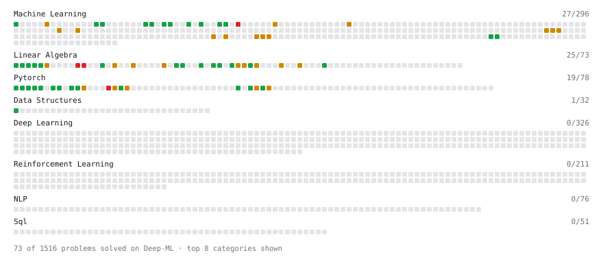

# Deep-ML

My machine learning practice from [Deep-ML](https://www.deep-ml.com). Every solution here was written by hand.

**134** solved · 104 problems · 3 labs · 27 math

[**Browse the interactive portfolio**](https://vtnguyen04.github.io/deep-ml/) to replay this filling in over time.

## Problems

| | Difficulty | Solved | |
| --- | --- | --- | --- |
| [Add a Bias Vector to a Batch via Broadcasting](https://www.deep-ml.com/problems/882) | easy | 2026-09-16 | [solution](problems/0882-add-a-bias-vector-to-a-batch-via-broadcasting) |
| [Backprop a Linear Layer by Hand](https://www.deep-ml.com/problems/898) | easy | 2026-10-12 | [solution](problems/0898-backprop-a-linear-layer-by-hand) |
| [Batch a TensorDataset with DataLoader](https://www.deep-ml.com/problems/1237) | easy | 2026-10-13 | [solution](problems/1237-batch-a-tensordataset-with-dataloader) |
| [Binary Classification with Logistic Regression](https://www.deep-ml.com/problems/104) | easy | 2026-09-14 | [solution](problems/0104-binary-classification-with-logistic-regression) |
| [Build a Dataset and Use It with a DataLoader](https://www.deep-ml.com/problems/899) | easy | 2026-10-12 | [solution](problems/0899-build-a-dataset-and-use-it-with-a-dataloader) |
| [Build a Linear Regression Model with nn.Module](https://www.deep-ml.com/problems/885) | easy | 2026-10-13 | [solution](problems/0885-build-a-linear-regression-model-with-nn-module) |
| [Build an MLP with nn.Sequential](https://www.deep-ml.com/problems/887) | easy | 2026-10-12 | [solution](problems/0887-build-an-mlp-with-nn-sequential) |
| [Calculate Accuracy Score](https://www.deep-ml.com/problems/36) | easy | 2026-09-14 | [solution](problems/0036-calculate-accuracy-score) |
| [Calculate Cosine Similarity Between Vectors](https://www.deep-ml.com/problems/76) | easy | 2026-09-13 | [solution](problems/0076-calculate-cosine-similarity-between-vectors) |
| [Calculate Mean Absolute Error (MAE)](https://www.deep-ml.com/problems/93) | easy | 2026-09-14 | [solution](problems/0093-calculate-mean-absolute-error-mae) |
| [Calculate Mean by Row or Column](https://www.deep-ml.com/problems/4) | easy | 2026-09-13 | [solution](problems/0004-calculate-mean-by-row-or-column) |
| [Calculate R-squared for Regression Analysis](https://www.deep-ml.com/problems/69) | easy | 2026-09-14 | [solution](problems/0069-calculate-r-squared-for-regression-analysis) |
| [Calculate Root Mean Square Error (RMSE)](https://www.deep-ml.com/problems/71) | easy | 2026-09-14 | [solution](problems/0071-calculate-root-mean-square-error-rmse) |
| [Check Linear Independence of Vectors](https://www.deep-ml.com/problems/331) | easy | 2026-09-13 | [solution](problems/0331-check-linear-independence-of-vectors) |
| [Compute a Gradient with PyTorch Autograd](https://www.deep-ml.com/problems/884) | easy | 2026-10-12 | [solution](problems/0884-compute-a-gradient-with-pytorch-autograd) |
| [Compute the Cross Product of Two 3D Vectors](https://www.deep-ml.com/problems/118) | easy | 2026-09-13 | [solution](problems/0118-compute-the-cross-product-of-two-3d-vectors) |
| [Convert Vector to Diagonal Matrix](https://www.deep-ml.com/problems/35) | easy | 2026-09-13 | [solution](problems/0035-convert-vector-to-diagonal-matrix) |
| [Count Parameters of a Sequential Model](https://www.deep-ml.com/problems/1218) | easy | 2026-10-13 | [solution](problems/1218-count-parameters-of-a-sequential-model) |
| [Create a Float Tensor from a Python List](https://www.deep-ml.com/problems/880) | easy | 2026-09-16 | [solution](problems/0880-create-a-float-tensor-from-a-python-list) |
| [Create and Inspect a Tensor](https://www.deep-ml.com/problems/1220) | easy | 2026-10-13 | [solution](problems/1220-create-and-inspect-a-tensor) |
| [Detect Overfitting or Underfitting](https://www.deep-ml.com/problems/86) | easy | 2026-09-14 | [solution](problems/0086-detect-overfitting-or-underfitting) |
| [Dot Product Calculator](https://www.deep-ml.com/problems/83) | easy | 2026-09-12 | [solution](problems/0083-dot-product-calculator) |
| [Generate a Confusion Matrix for Binary Classification](https://www.deep-ml.com/problems/75) | easy | 2026-09-14 | [solution](problems/0075-generate-a-confusion-matrix-for-binary-classification) |
| [Gradient of a Square with Autograd](https://www.deep-ml.com/problems/1222) | easy | 2026-10-13 | [solution](problems/1222-gradient-of-a-square-with-autograd) |
| [Implement a Linear Layer Forward Pass with Matrix Multiplication](https://www.deep-ml.com/problems/883) | easy | 2026-09-16 | [solution](problems/0883-implement-a-linear-layer-forward-pass-with-matrix-multiplication) |
| [Implement Dropout from Scratch](https://www.deep-ml.com/problems/901) | easy | 2026-10-13 | [solution](problems/0901-implement-dropout-from-scratch) |
| [Implement F-Score Calculation for Binary Classification](https://www.deep-ml.com/problems/61) | easy | 2026-09-14 | [solution](problems/0061-implement-f-score-calculation-for-binary-classification) |
| [Implement LayerNorm from Scratch](https://www.deep-ml.com/problems/908) | easy | 2026-10-12 | [solution](problems/0908-implement-layernorm-from-scratch) |
| [Implement Recall Metric in Binary Classification](https://www.deep-ml.com/problems/52) | easy | 2026-09-14 | [solution](problems/0052-implement-recall-metric-in-binary-classification) |
| [Implement ReLU and Leaky ReLU](https://www.deep-ml.com/problems/1226) | easy | 2026-09-16 | [solution](problems/1226-implement-relu-and-leaky-relu) |
| [Implement Triplet Loss](https://www.deep-ml.com/problems/916) | easy | 2026-10-12 | [solution](problems/0916-implement-triplet-loss) |
| [Implement Weight Decay as L2 Regularization](https://www.deep-ml.com/problems/198) | easy | 2026-09-15 | [solution](problems/0198-implement-weight-decay-as-l2-regularization) |
| [L2 Normalization Along an Axis](https://www.deep-ml.com/problems/1022) | easy | 2026-09-13 | [solution](problems/1022-l2-normalization-along-an-axis) |
| [Linear Regression Using Normal Equation](https://www.deep-ml.com/problems/14) | easy | 2026-09-14 | [solution](problems/0014-linear-regression-using-normal-equation) |
| [Matrix Determinant & Trace](https://www.deep-ml.com/problems/195) | easy | 2026-09-13 | [solution](problems/0195-matrix-determinant-trace) |
| [Matrix-Vector Dot Product](https://www.deep-ml.com/problems/1) | easy | 2026-09-13 | [solution](problems/0001-matrix-vector-dot-product) |
| [Mean Squared Error from Scratch](https://www.deep-ml.com/problems/1228) | easy | 2026-09-16 | [solution](problems/1228-mean-squared-error-from-scratch) |
| [Min-Max Scaling of Feature Values](https://www.deep-ml.com/problems/112) | easy | 2026-09-14 | [solution](problems/0112-min-max-scaling-of-feature-values) |
| [One-Hot Encoding of Nominal Values](https://www.deep-ml.com/problems/34) | easy | 2026-09-14 | [solution](problems/0034-one-hot-encoding-of-nominal-values) |
| [Pairwise Cosine Similarity Matrix](https://www.deep-ml.com/problems/1072) | easy | 2026-09-13 | [solution](problems/1072-pairwise-cosine-similarity-matrix) |
| [Random Train/Validation/Test Split with Shuffling](https://www.deep-ml.com/problems/1058) | easy | 2026-09-14 | [solution](problems/1058-random-train-validation-test-split-with-shuffling) |
| [Reshape and Transpose a Tensor](https://www.deep-ml.com/problems/881) | easy | 2026-09-16 | [solution](problems/0881-reshape-and-transpose-a-tensor) |
| [Reshape and Transpose a Tensor](https://www.deep-ml.com/problems/1221) | easy | 2026-10-13 | [solution](problems/1221-reshape-and-transpose-a-tensor) |
| [Reshape Matrix](https://www.deep-ml.com/problems/3) | easy | 2026-09-13 | [solution](problems/0003-reshape-matrix) |
| [Run One Training Step: Forward, Loss, Backward, Optimizer](https://www.deep-ml.com/problems/886) | easy | 2026-10-12 | [solution](problems/0886-run-one-training-step-forward-loss-backward-optimizer) |
| [Save and Load Model Weights with state_dict](https://www.deep-ml.com/problems/888) | easy | 2026-10-13 | [solution](problems/0888-save-and-load-model-weights-with-state-dict) |
| [Scalar Multiplication of a Matrix](https://www.deep-ml.com/problems/5) | easy | 2026-09-13 | [solution](problems/0005-scalar-multiplication-of-a-matrix) |
| [Single Linear Neuron Forward](https://www.deep-ml.com/problems/1224) | easy | 2026-09-16 | [solution](problems/1224-single-linear-neuron-forward) |
| [Sinusoidal Positional Encoding](https://www.deep-ml.com/problems/906) | easy | 2026-10-12 | [solution](problems/0906-sinusoidal-positional-encoding) |
| [Transpose of a Matrix](https://www.deep-ml.com/problems/2) | easy | 2026-09-13 | [solution](problems/0002-transpose-of-a-matrix) |
| [Vector Element-wise Sum](https://www.deep-ml.com/problems/121) | easy | 2026-09-12 | [solution](problems/0121-vector-element-wise-sum) |
| [Vector Norms (L1/L2/L-inf) and the Frobenius Norm](https://www.deep-ml.com/problems/328) | easy | 2026-09-12 | [solution](problems/0328-vector-norms-l1-l2-l-inf-and-the-frobenius-norm) |
| [A collate_fn for Variable-Length Sequences](https://www.deep-ml.com/problems/1348) | medium | 2026-10-13 | [solution](problems/1348-a-collate-fn-for-variable-length-sequences) |
| [BatchNorm1d Forward in Eval Mode](https://www.deep-ml.com/problems/1231) | medium | 2026-10-13 | [solution](problems/1231-batchnorm1d-forward-in-eval-mode) |
| [Binary Cross-Entropy from Logits](https://www.deep-ml.com/problems/1229) | medium | 2026-09-16 | [solution](problems/1229-binary-cross-entropy-from-logits) |
| [Calculate Eigenvalues of a Matrix](https://www.deep-ml.com/problems/6) | medium | 2026-09-13 | [solution](problems/0006-calculate-eigenvalues-of-a-matrix) |
| [Calculate Explained Variance Ratio for PCA](https://www.deep-ml.com/problems/350) | medium | 2026-09-15 | [solution](problems/0350-calculate-explained-variance-ratio-for-pca) |
| [Capture Activations with Forward Hooks](https://www.deep-ml.com/problems/1340) | medium | 2026-10-13 | [solution](problems/1340-capture-activations-with-forward-hooks) |
| [Check if Matrix is Positive Definite](https://www.deep-ml.com/problems/332) | medium | 2026-09-13 | [solution](problems/0332-check-if-matrix-is-positive-definite) |
| [Compute the Null Space (Kernel) of a Matrix](https://www.deep-ml.com/problems/330) | medium | 2026-09-13 | [solution](problems/0330-compute-the-null-space-kernel-of-a-matrix) |
| [Dropout in Train vs Eval Mode](https://www.deep-ml.com/problems/1230) | medium | 2026-10-13 | [solution](problems/1230-dropout-in-train-vs-eval-mode) |
| [Dummy Classifier Baseline](https://www.deep-ml.com/problems/847) | medium | 2026-09-14 | [solution](problems/0847-dummy-classifier-baseline) |
| [Dummy Regressor Baseline](https://www.deep-ml.com/problems/848) | medium | 2026-09-14 | [solution](problems/0848-dummy-regressor-baseline) |
| [Elastic Net Regression via Gradient Descent](https://www.deep-ml.com/problems/139) | medium | 2026-09-15 | [solution](problems/0139-elastic-net-regression-via-gradient-descent) |
| [Exponential Moving Average of Model Weights](https://www.deep-ml.com/problems/1344) | medium | 2026-10-13 | [solution](problems/1344-exponential-moving-average-of-model-weights) |
| [Find the column space of a matrix](https://www.deep-ml.com/problems/68) | medium | 2026-09-13 | [solution](problems/0068-find-the-column-space-of-a-matrix) |
| [Gaussian Elimination for Solving Linear Systems](https://www.deep-ml.com/problems/58) | medium | 2026-09-13 | [solution](problems/0058-gaussian-elimination-for-solving-linear-systems) |
| [Gradient Accumulation Over Micro-Batches](https://www.deep-ml.com/problems/912) | medium | 2026-10-13 | [solution](problems/0912-gradient-accumulation-over-micro-batches) |
| [Gradient Clipping by Norm](https://www.deep-ml.com/problems/909) | medium | 2026-10-12 | [solution](problems/0909-gradient-clipping-by-norm) |
| [Implement a Custom `autograd.Function`](https://www.deep-ml.com/problems/903) | medium | 2026-10-13 | [solution](problems/0903-implement-a-custom-autograd-function) |
| [Implement a Transformer Encoder Block](https://www.deep-ml.com/problems/905) | medium | 2026-10-12 | [solution](problems/0905-implement-a-transformer-encoder-block) |
| [Implement a Trie for Prefix Matching](https://www.deep-ml.com/problems/1083) | medium | 2026-10-14 | [solution](problems/1083-implement-a-trie-for-prefix-matching) |
| [Implement an LSTM Cell from Scratch](https://www.deep-ml.com/problems/907) | medium | 2026-10-12 | [solution](problems/0907-implement-an-lstm-cell-from-scratch) |
| [Implement Conv2d with `unfold`](https://www.deep-ml.com/problems/900) | medium | 2026-10-12 | [solution](problems/0900-implement-conv2d-with-unfold) |
| [Implement Reduced Row Echelon Form (RREF) Function](https://www.deep-ml.com/problems/48) | medium | 2026-09-13 | [solution](problems/0048-implement-reduced-row-echelon-form-rref-function) |
| [Implement Stratified K-Fold Cross-Validation](https://www.deep-ml.com/problems/840) | medium | 2026-09-15 | [solution](problems/0840-implement-stratified-k-fold-cross-validation) |
| [Implement the Huber Loss Function](https://www.deep-ml.com/problems/192) | medium | 2026-09-15 | [solution](problems/0192-implement-the-huber-loss-function) |
| [Matrix Rank](https://www.deep-ml.com/problems/329) | medium | 2026-09-13 | [solution](problems/0329-matrix-rank) |
| [Mini-Batch Gradient Descent Step for Linear Regression](https://www.deep-ml.com/problems/803) | medium | 2026-09-14 | [solution](problems/0803-mini-batch-gradient-descent-step-for-linear-regression) |
| [Mixed-Precision Forward with `autocast`](https://www.deep-ml.com/problems/911) | medium | 2026-10-13 | [solution](problems/0911-mixed-precision-forward-with-autocast) |
| [Newton-Schulz Iteration for Approximate Orthogonalization](https://www.deep-ml.com/problems/739) | medium | 2026-09-13 | [solution](problems/0739-newton-schulz-iteration-for-approximate-orthogonalization) |
| [nn.ModuleList vs a Plain Python List](https://www.deep-ml.com/problems/1341) | medium | 2026-10-13 | [solution](problems/1341-nn-modulelist-vs-a-plain-python-list) |
| [Numerically Stable Cross-Entropy](https://www.deep-ml.com/problems/914) | medium | 2026-10-13 | [solution](problems/0914-numerically-stable-cross-entropy) |
| [Numerically Stable Softmax](https://www.deep-ml.com/problems/1227) | medium | 2026-09-16 | [solution](problems/1227-numerically-stable-softmax) |
| [Parameter Groups and Freezing for Transfer Learning](https://www.deep-ml.com/problems/1343) | medium | 2026-10-13 | [solution](problems/1343-parameter-groups-and-freezing-for-transfer-learning) |
| [Persistent LRU Cache](https://www.deep-ml.com/problems/1095) | medium | 2026-10-13 | [solution](problems/1095-persistent-lru-cache) |
| [Polynomial Regression Fit](https://www.deep-ml.com/problems/801) | medium | 2026-09-15 | [solution](problems/0801-polynomial-regression-fit) |
| [Precision and Recall at Threshold](https://www.deep-ml.com/problems/849) | medium | 2026-09-14 | [solution](problems/0849-precision-and-recall-at-threshold) |
| [Principal Component Analysis (PCA) Implementation](https://www.deep-ml.com/problems/19) | medium | 2026-09-15 | [solution](problems/0019-principal-component-analysis-pca-implementation) |
| [Reconstruction Error from PCA](https://www.deep-ml.com/problems/353) | medium | 2026-09-15 | [solution](problems/0353-reconstruction-error-from-pca) |
| [Register Parameters and Buffers on a Custom Module](https://www.deep-ml.com/problems/1339) | medium | 2026-10-13 | [solution](problems/1339-register-parameters-and-buffers-on-a-custom-module) |
| [StandardScaler Fit and Transform](https://www.deep-ml.com/problems/842) | medium | 2026-09-14 | [solution](problems/0842-standardscaler-fit-and-transform) |
| [Stochastic Gradient Descent Step for Linear Regression](https://www.deep-ml.com/problems/802) | medium | 2026-09-14 | [solution](problems/0802-stochastic-gradient-descent-step-for-linear-regression) |
| [Truncated SVD Rank-r Approximation of Weight Updates](https://www.deep-ml.com/problems/872) | medium | 2026-09-13 | [solution](problems/0872-truncated-svd-rank-r-approximation-of-weight-updates) |
| [Two-Layer MLP Forward Pass](https://www.deep-ml.com/problems/1225) | medium | 2026-10-13 | [solution](problems/1225-two-layer-mlp-forward-pass) |
| [A KV Cache for Autoregressive Decoding](https://www.deep-ml.com/problems/1345) | hard | 2026-10-13 | [solution](problems/1345-a-kv-cache-for-autoregressive-decoding) |
| [Build a Tiny GPT](https://www.deep-ml.com/problems/918) | hard | 2026-10-12 | [solution](problems/0918-build-a-tiny-gpt) |
| [Causal and Padding Masks with scaled_dot_product_attention](https://www.deep-ml.com/problems/1346) | hard | 2026-10-13 | [solution](problems/1346-causal-and-padding-masks-with-scaled-dot-product-attention) |
| [Determinant of a 4x4 Matrix using Laplace's Expansion (hard)](https://www.deep-ml.com/problems/13) | hard | 2026-09-13 | [solution](problems/0013-determinant-of-a-4x4-matrix-using-laplace-s-expansion-hard) |
| [Implement Multi-Head Self-Attention](https://www.deep-ml.com/problems/904) | hard | 2026-10-12 | [solution](problems/0904-implement-multi-head-self-attention) |
| [Rotary Position Embeddings (RoPE)](https://www.deep-ml.com/problems/1347) | hard | 2026-10-13 | [solution](problems/1347-rotary-position-embeddings-rope) |
| [Singular Value Decomposition (SVD) of 2x2 Matrix](https://www.deep-ml.com/problems/12) | hard | 2026-09-13 | [solution](problems/0012-singular-value-decomposition-svd-of-2x2-matrix) |
| [Trade Compute for Memory with Gradient Checkpointing](https://www.deep-ml.com/problems/1342) | hard | 2026-10-13 | [solution](problems/1342-trade-compute-for-memory-with-gradient-checkpointing) |
| [Train Logistic Regression with Gradient Descent](https://www.deep-ml.com/problems/106) | hard | 2026-09-14 | [solution](problems/0106-train-logistic-regression-with-gradient-descent) |

## Labs

| | Difficulty | Solved | |
| --- | --- | --- | --- |
| [Split the Data Honestly and Beat a Baseline](https://www.deep-ml.com/labs/3d26c3f9-cb73-4ab1-bc4d-86cfab2af6d1) | easy | 2026-09-14 | [solution](labs/3d26c3f9-cb73-4ab1-bc4d-86cfab2af6d1-split-the-data-honestly-and-beat-a-baseline) |
| [Train a Linear Regression Model](https://www.deep-ml.com/labs/18) | easy | 2026-09-13 | [solution](labs/0018-train-a-linear-regression-model) |
| [Data Preprocessing: Handling Missing Values](https://www.deep-ml.com/labs/11) | medium | 2026-09-14 | [solution](labs/0011-data-preprocessing-handling-missing-values) |

## Math

| | Difficulty | Solved | |
| --- | --- | --- | --- |
| [Derivatives and Gradients](https://www.deep-ml.com/math-problems/1) | easy | 2026-09-13 | [solution](math/0001-derivatives-and-gradients) |
| [Descriptive Statistics](https://www.deep-ml.com/math-problems/18) | easy | 2026-09-14 | [solution](math/0018-descriptive-statistics) |
| [Expectation and Variance Algebra](https://www.deep-ml.com/math-problems/33) | easy | 2026-09-14 | [solution](math/0033-expectation-and-variance-algebra) |
| [Gradient Descent Updates](https://www.deep-ml.com/math-problems/5) | easy | 2026-09-14 | [solution](math/0005-gradient-descent-updates) |
| [Matrix Basics](https://www.deep-ml.com/math-problems/9) | easy | 2026-09-12 | [solution](math/0009-matrix-basics) |
| [ML Workflow Basics](https://www.deep-ml.com/math-problems/30) | easy | 2026-09-14 | [solution](math/0030-ml-workflow-basics) |
| [Model Selection: CV, AIC, and BIC](https://www.deep-ml.com/math-problems/43) | easy | 2026-09-15 | [solution](math/0043-model-selection-cv-aic-and-bic) |
| [Vector Operations](https://www.deep-ml.com/math-problems/7) | easy | 2026-09-12 | [solution](math/0007-vector-operations) |
| [Bias–Variance Decomposition](https://www.deep-ml.com/math-problems/39) | medium | 2026-09-15 | [solution](math/0039-bias-variance-decomposition) |
| [Covariance and Correlation](https://www.deep-ml.com/math-problems/17) | medium | 2026-09-13 | [solution](math/0017-covariance-and-correlation) |
| [Determinants and Trace](https://www.deep-ml.com/math-problems/11) | medium | 2026-09-13 | [solution](math/0011-determinants-and-trace) |
| [Information Theory: Entropy](https://www.deep-ml.com/math-problems/24) | medium | 2026-09-15 | [solution](math/0024-information-theory-entropy) |
| [Inverse and Rank](https://www.deep-ml.com/math-problems/12) | medium | 2026-09-13 | [solution](math/0012-inverse-and-rank) |
| [Least Squares and the Normal Equations](https://www.deep-ml.com/math-problems/34) | medium | 2026-09-14 | [solution](math/0034-least-squares-and-the-normal-equations) |
| [Logistic Regression as Maximum Likelihood](https://www.deep-ml.com/math-problems/40) | medium | 2026-09-14 | [solution](math/0040-logistic-regression-as-maximum-likelihood) |
| [Matrix Calculus Identities](https://www.deep-ml.com/math-problems/35) | medium | 2026-09-13 | [solution](math/0035-matrix-calculus-identities) |
| [Matrix Multiplication](https://www.deep-ml.com/math-problems/10) | medium | 2026-09-12 | [solution](math/0010-matrix-multiplication) |
| [Optimization: Convexity and Critical Points](https://www.deep-ml.com/math-problems/6) | medium | 2026-09-15 | [solution](math/0006-optimization-convexity-and-critical-points) |
| [PCA via Covariance Eigendecomposition](https://www.deep-ml.com/math-problems/49) | medium | 2026-09-13 | [solution](math/0049-pca-via-covariance-eigendecomposition) |
| [Positive Definite Matrices and Quadratic Forms](https://www.deep-ml.com/math-problems/50) | medium | 2026-09-13 | [solution](math/0050-positive-definite-matrices-and-quadratic-forms) |
| [Regularization and Generalization](https://www.deep-ml.com/math-problems/31) | medium | 2026-09-14 | [solution](math/0031-regularization-and-generalization) |
| [Solving Linear Systems](https://www.deep-ml.com/math-problems/13) | medium | 2026-09-13 | [solution](math/0013-solving-linear-systems) |
| [The Four Fundamental Subspaces](https://www.deep-ml.com/math-problems/46) | medium | 2026-09-13 | [solution](math/0046-the-four-fundamental-subspaces) |
| [Vector Norms and Linear Independence](https://www.deep-ml.com/math-problems/8) | medium | 2026-09-12 | [solution](math/0008-vector-norms-and-linear-independence) |
| [Eigendecomposition and SVD](https://www.deep-ml.com/math-problems/16) | hard | 2026-09-13 | [solution](math/0016-eigendecomposition-and-svd) |
| [Matrix Decompositions: LU and QR](https://www.deep-ml.com/math-problems/15) | hard | 2026-09-13 | [solution](math/0015-matrix-decompositions-lu-and-qr) |
| [Maximum Likelihood and MAP](https://www.deep-ml.com/math-problems/26) | hard | 2026-09-15 | [solution](math/0026-maximum-likelihood-and-map) |

---

_This file is regenerated by Deep-ML on every push._
